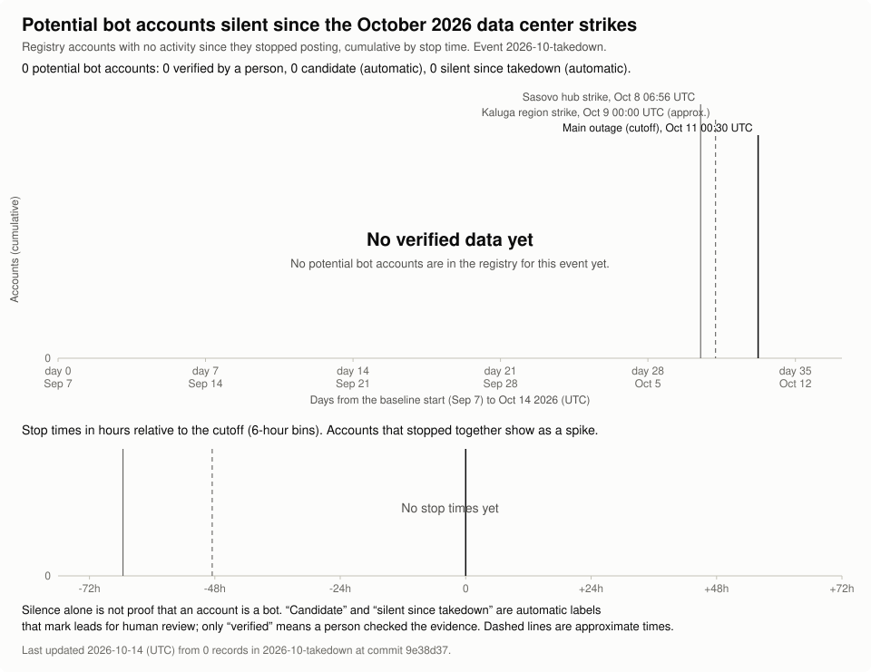

# Data analysis

This file holds the analysis behind the results in the [README](README.md): the
current figures and how they were scored, the run-by-run detail, the method, and the
limitations. The README keeps the chart, the TL;DR and a short guide to running scans,
and [CONTRIBUTING.md](CONTRIBUTING.md) has the full guide to contributing. Instructions
for installing and running the tool are in [docs/USAGE.md](docs/USAGE.md).

> Candidates for manual review. Output is not a determination that any account is a bot.

Contents:

- [Results](#results)
- [What the tool measures](#what-the-tool-measures)
- [Current figures](#current-figures)
- [Pending work](#pending-work)
- [Run 4 (partial) and all runs](#run-4-partial-and-all-runs)
- [Runs 1 to 3 (provisional)](#runs-1-to-3-provisional)
- [Method](#method)
  - [Placebo cutoffs](#placebo-cutoffs)
- [Limitations](#limitations)
- [The main graph: every platform](#the-main-graph-every-platform)
- [Shared registry chart](#shared-registry-chart)

## Results

These are the provisional results of the Reddit archive scans of event `2026-10-takedown`
(cutoff 2026-10-11 00:30 UTC), re-scored on 2026-10-20 from a backup copy of the cache.
Every row is scored as of its run's stored data horizon, and no later activity counts. An
eligible account posted steadily in the 30-day baseline window before the outage, and a
silent one stopped posting around the outage and had no activity seen up to its run's
horizon. The method is in [Method](#method).

| Row | Silence window (data horizon) | Eligible | Silent | Share | 95% Wilson interval |
| --- | --- | --- | --- | --- | --- |
| Run 1 | 3.28 days (2026-10-14 07:10 UTC) | 6,398 | 287 | 4.49%, about 1 in 22 | 4.01% to 5.02% |
| Run 2 | 3.28 to 4.0 days (2026-10-15 00:30 UTC; 2026-10-14 07:10 UTC for accounts whose data ends early) | 6,324 | 213 | 3.37%, about 1 in 30 | 2.95% to 3.84% |
| Run 3 | 4.0 days (2026-10-15 00:30 UTC) | 12,733 | 421 | 3.31%, about 1 in 30 | 3.01% to 3.63% |
| Runs 1 to 3, each distinct account counted once | 3.3 to 4.0 days | 19,868 | 698 | 3.51%, about 1 in 28 | 3.27% to 3.78% |
| Run 4, partial and still being scanned | 7.86 days (2026-10-18 21:10 UTC) | 7,179 | 103 | 1.43%, about 1 in 70 | 1.18% to 1.74% |
| All runs pooled, each distinct account counted once | Mixed, 3.3 to 7.86 days | 23,745 | 681 | 2.87%, about 1 in 35 | 2.66% to 3.09% |

Ordinary weeks, from placebo cutoffs on Sep 6, 13 and 20 2026 (692,252 eligible
accounts), give 4.20% for 3 days of silence and 0.86% for 7 days.

- The runs share accounts, so their rows are never added together. The rows that count
  each distinct account once use its record from the run with the longest scored window.
- No row of runs 1 to 3 is clearly above an ordinary week.
- Run 4 is the only run scored past 7 days. Its 1.43% is above the 7-day ordinary-week
  rate of 0.86%, but this is a hint and not a finding: the run was stopped at 11,201 of
  30,000 accounts fetched and then resumed, the fetched part is not a random subsample of
  its draw (reweighted to the full draw's community mix, the rate is 1.44%), and the
  figure will change when the run finishes.
- The pooled row mixes windows, so it compares with neither ordinary-week rate.
- These are not counts of bots, and there is no verdict. Silence alone is not proof that
  an account is a bot, and the outage also silenced ordinary users of the services it cut
  off.

The details are in [Current figures](#current-figures),
[Run 4 (partial) and all runs](#run-4-partial-and-all-runs) and
[Runs 1 to 3 (provisional)](#runs-1-to-3-provisional). The shared
registry holds only `scanned` records so far, so its chart of potential bot accounts
shows none yet (see [Shared registry chart](#shared-registry-chart)).

## What the tool measures

Bot Farm Silence Tracker is a research tool for disinformation analysts. It samples
Reddit, Bluesky or X accounts from seed communities and flags accounts that **posted
steadily for 30 days and then went silent at a cutoff**: the moment of a named outage
event, such as the reported outage that the default event in
[`events.toml`](events.toml) describes (see [Outage events](docs/USAGE.md#outage-events)). The
motivating case: data centers reported to host coordinated accounts were reportedly
taken offline, so bots running there would stop together. But the same outage also
cut off ordinary people who used the affected services, so a shared stop means first
of all "affected by the outage". The tool therefore compares every run with placebo
cutoffs in ordinary earlier weeks, tests stop-time clusters against the accounts' own
posting hours, and asks for evidence independent of the outage's timing before an
account becomes a candidate for review (see [Method](#method) and
[Limitations](#limitations)).

## Current figures

Every figure in the [README's TL;DR](README.md#tldr) is scored as of each run's stored data horizon, with no later activity counted. The per-window figures should not be compared directly: a longer window leaves fewer accounts silent, because some accounts that were quiet for 3 or 4 days post again later. Of the accounts that were also fetched in run 4, 120 are silent on their record in the de-duplicated runs 1 to 3 union (the record with the longest earlier window, 3.3 to 4.0 days), and 52 of those 120 were still silent at 7.86 days. See [Run 4 (partial) and all runs](#run-4-partial-and-all-runs) for the details. The chart at the top of the README shows the current figures. The tables in [Runs 1 to 3 (provisional)](#runs-1-to-3-provisional) are an earlier snapshot, from 2026-10-17 when run 3 was still partial; the current per-run figures are listed below.

The chart at the top of the README shows these figures. Each run of the 2026-10-takedown
Reddit scan is scored as of the archive's data horizon stored with it, not up to a later
time, so runs 1 to 3 have not reached 7 days of silence: run 1 is scored over 3.28 days,
run 2 over 3.28 to 4.0 days, and run 3 over 4.0 days. Run 4 is scored over 7.86 days.

Re-scored on 2026-10-20 at each run's stored horizon, from a backup copy of the cache:

- Run 1 (main sample complete): 287 of 6,398 eligible accounts silent, 4.49% (95% Wilson
  interval 4.01% to 5.02%). The snapshot gave 288 of 6,399; a re-score reads the cache as
  it is now, so a count can drift slightly between re-scores.
- Run 2 (complete, 10,000 fetched): 213 of 6,324, 3.37% (2.95% to 3.84%). The snapshot gave
  214. Accounts whose data ends early are counted only up to 2026-10-14 07:10 UTC (their
  stored horizon).
- Run 3 (complete, 19,998 of 20,000 fetched): 421 of 12,733, 3.31% (3.01% to 3.63%). The
  snapshot, with 9,119 accounts fetched, gave 182 of 5,943 (3.06%).
- All distinct accounts across runs 1 to 3 (31,396, counted once each, excluding fetch errors): 698 of 19,868,
  3.51% (3.27% to 3.78%).
- Run 4 (partial, 7.86 days) and all runs pooled: see
  [Run 4 (partial) and all runs](#run-4-partial-and-all-runs).

Ordinary weeks give 4.20% for 3 days of silence. The windows of runs 1 to 3 are longer
than 3 days, so a matched base rate is lower. A straight-line interpolation (a rough
estimate, not a measurement) gives about 3.97% at 3.28 days and 3.37% at 4.0 days. The
unmatched 4.20% comparison is therefore conservative. In the chart, against the matched
values, run 1 is slightly higher (its interval sits just above 3.97%) and the interval of
every other row of runs 1 to 3 overlaps its matched value or range, as it did in the
snapshot of 2026-10-17. No row of runs 1 to 3 is clearly above an ordinary week. Run 1 and run 3 differ partly because of their windows and sample makeup, and the
rest is not explained. The runs share accounts, so they are not independent checks and
their rows are never summed. There is no verdict: run 4 is the only run scored past 7
days and it is partial, and runs 1 to 3 must be fetched again before they can be scored
over 7 days. Silence alone is not proof that an account is a bot. See
[Runs 1 to 3 (provisional)](#runs-1-to-3-provisional) for the snapshot's numbers and
caveats.

## Pending work

A 7-day rescore of runs 1 to 3 (their data ends at their stored horizons, so they must be fetched again), the rest of run 4 (resumed and running), a fifth, independent sample (10,000 accounts, for the same 2026-10-11 00:30 UTC cutoff), historical baseline samples from ordinary weeks of July to September 2024 to 2026, and a second event, the reported strike on a VK data center (cutoff about 2026-10-17 23:50 UTC, unverified). The fifth sample and the baseline samples are queued and deliberately paused until run 4 finishes. The run labels in the README and in this file are not the run IDs in the scan database.

## Run 4 (partial) and all runs

Run 4 is a fourth Reddit archive scan of event `2026-10-takedown` (cutoff 2026-10-11 00:30
UTC), with its own seed and a draw of 30,000 accounts. Its data horizon is 2026-10-18
21:10 UTC, 7.86 days after the cutoff, so it is the first run scored past 7 days of
silence. The operator stopped it on 2026-10-20 at 20:28 UTC, at 11,201 of 30,000 accounts
fetched (excluding 6 fetch errors), because the archive had slowed down. The slowdown came
from throttling on the archive's side: HTTP 422 timeout refusals rose from 5% to 7% of
requests on October 15 to 17 to about 21% on October 20, and the scan's own waits between
retries made it worse. The scan was resumed on 2026-10-20 at about 21:17 UTC, with a higher
concurrency and shorter retry waits, and with the same data horizon (2026-10-18 21:10 UTC),
so the accounts already fetched are reused and only the pending ones are being fetched. The
figures below are for the stopped part, scored with the run's stored rules (at least 3 days
of silence) as of its stored horizon, from a backup copy of the cache. They will change when
the run completes.

| Measure | Run 4 (partial) |
| --- | --- |
| Accounts fetched and scored | 11,201 of 30,000, excluding fetch errors (11,207 attempted, of which 6 were fetch errors; 6 histories cut short by the platform cap) |
| Scored through (data horizon) | 2026-10-18 21:10 UTC |
| Silence window | 7.86 days |
| Eligible (steady posters in the baseline) | 7,179 |
| Went silent | 103, or 1.43% (95% Wilson interval 1.18% to 1.74%) |
| Reweighted to the full draw's community mix | 1.44% (bootstrap 95% interval 1.16% to 1.72%) |
| Stop-time clusters | 31 (the largest has 4 accounts); not permutation-tested yet, unlike runs 1 to 3 |
| Accounts in no earlier run | 6,029 fetched and scored (excluding 3 fetch errors), 51 of 3,877 eligible silent, 1.32% (1.00% to 1.73%) |

The fetched part is not a random subsample of run 4's draw:

- The sample is drawn with a reservoir sample over the discovery stream and is fetched in
  slot order, which is close to discovery order. Discovery visits the seed communities in
  rounds, and accounts found early are more likely to be frequent posters.
- The mix of discovery communities differs between the fetched part and the rest. For
  example, r/energy is 3.2% of the fetched part and 6.2% of the rest, and r/politics 9.3%
  against 7.4%.
- The full 30,000-account draw would be a valid random sample of the discovered pool once it
  is fetched completely. The fetched part is a convenience subset.
- The reweighted figure post-stratifies by discovery community: within each of the 21
  discovery communities it takes the eligible share and the silent share of the fetched part,
  and weights the communities by their counts in the full draw (all 30,000 accounts, including
  the ones not yet fetched). Its interval comes from 2,000 bootstrap resamples within
  communities. Reweighting corrects only the community mix, not other differences between
  early and late accounts, such as posting frequency within a community.

How to read run 4:

- The ordinary-week rate for 7 days of silence is 0.86% (weekly values 0.82% to 0.89%).
  Run 4's 1.43% is above it, and its interval does not reach it. This is a hint only, not
  a finding: the subsample is not random; the archive may lag, so posts that it has not yet
  ingested look like silence; the window is 7.86 days rather than 7; and the ordinary-week
  rate comes from a separate script whose eligibility rules have not been checked to be
  identical.
- Run 4 shares 5,172 of its fetched accounts with runs 1 to 3. Of these, 126 went silent in
  at least one of runs 1 to 3. On the de-duplicated runs 1 to 3 union record (each account's
  record with the longest earlier window, 3.3 to 4.0 days), 120 of them are silent; the
  other 6 were silent at 3.28 days in run 1 but had posted again by 4.0 days in a later run.
  Of those 120, 52 (43%) were still silent at 7.86 days and 68 had posted again. No shared
  account was silent in run 4 only.
- Two rough estimates of the 7-day rate for runs 1 to 3 point the same way as run 4. Both are
  hints only, not findings:
  - Spot check: of 50 accounts drawn at random from the 698 that went silent in runs 1 to 3,
    26 were still silent after a week. That is 52% of 3.51%, about 1.8% (1.35% to 2.29%,
    from the Wilson interval of 26 of 50). That interval covers only the uncertainty of
    the 26/50 share; archive lag also applies.
  - Overlap: 52 of the 120 shared silent accounts, 43%, were still silent at 7.86 days (95%
    Wilson interval about 35% to 52%). Multiplying the runs 1 to 3 rate (698 of 19,868,
    3.51%) by 52/120 gives about 1.5%, and multiplying it by the Wilson bounds (0.348 and
    0.523) gives 1.2% to 1.8%. That interval covers only the uncertainty of the 43% share,
    not that of the 3.51%. The 120 are not a random draw from the 698: they are the silent
    accounts that run 4 happened to fetch, which is not a random part of its draw.
- Silence alone is not proof that an account is a potential bot account. The outage also
  silenced ordinary users, and a share of accounts goes quiet in any week. The archive keeps
  no account state, so deleted, suspended and abandoned accounts all look like silence.
- Run 4's 31 stop-time clusters (the largest has 4 accounts) have not been permutation-tested
  yet, unlike the clusters of runs 1 to 3.

All runs pooled, counted once per distinct account (the key is platform and account ID; an
account in several runs counts once, using its record from the run with the longest scored
window, with ties going to the lowest run number; rows of different runs are never added
together; records with a fetch error are not used, so they never replace an earlier eligible
record of the same account):

| Measure | All runs | Scored over 7.86 days (run 4) | Scored over 3.3 to 4.0 days (runs 1 to 3) |
| --- | --- | --- | --- |
| Distinct accounts scored (excluding fetch errors) | 37,425 | 11,201 | 26,224 |
| Eligible | 23,745 | 7,179 | 16,566 |
| Went silent | 681, or 2.87% (2.66% to 3.09%) | 103, or 1.43% (1.18% to 1.74%) | 578, or 3.49% (3.22% to 3.78%) |

- The "all runs" figure mixes two windows, and a longer window leaves fewer accounts silent.
  It therefore matches neither the 3-day nor the 7-day ordinary-week rate, and it should
  not be compared with them or with the per-window columns. Its value depends mostly on how
  many accounts happen to come from each window.
- The pooled figure is lower than the runs 1 to 3 union (698 of 19,868) because run 4's
  accounts, including the 5,172 it shares with runs 1 to 3, are scored on its longer window.
- The per-window columns are the comparable figures: the 7.86-day column against the 7-day
  ordinary-week rate, and the 3.3 to 4.0-day column against the 3-day rate, with the
  caveats above.

## Runs 1 to 3 (provisional)

The chart at the top of the README shows the current figures, re-scored on 2026-10-20.

These are provisional results of three Reddit archive scans of event `2026-10-takedown`
(different seeds). They show counts only. The tables in this section are an earlier
snapshot, which an earlier version of the chart showed: all runs were scored from the cache as of 2026-10-17 14:42 UTC, against a
cutoff of 2026-10-11 00:30 UTC. At that time run 1 had fetched its whole main sample and was
drawing placebo samples, run 2 was complete, and run 3 was partial (9,119 of 20,000
fetched). Run 3 has since completed. The figures re-scored on 2026-10-20 are shown in the
chart and listed in [Current figures](#current-figures), and they replace the counts in this section where they
differ.

One rule applies to every row: each run is scored as of the archive data horizon stored
with it, and no later activity counts. That is 2026-10-14 07:10 UTC for run 1 and
2026-10-15 00:30 UTC for runs 2 and 3. None of runs 1 to 3 has reached 7 days of silence,
so their 7-day comparison is still pending. A longer window needs the archive to cover
it and the accounts to be fetched again.

The tool's own counts do not all follow that rule, so they are not used here:

- The scan's console count for run 2 is 205 silent. It includes posts made after the horizon
  up to the time the accounts were fetched, so it is a longer window and not comparable
  with the other rows.
- `report` on a run that was still running at the time of the snapshot (runs 1 and 3) scores up to the run's reference
  time, which is later than its horizon (run 3: 2026-10-16 17:31 UTC, giving 126 silent over
  a longer window than the stated 4.0 days, and run 1: 287). `report` on a completed run
  (run 2) clips at the stored window end and gives 214. For this table, runs 1 and 3 were
  re-scored on a backup copy with the reference time set to the stored horizon.
- A re-score reads the cache as it is now, which can include rows merged in by later runs
  (the tool's documentation says so for runs without a stored window end), so a count can drift between re-scores. A follow-up
  to make the report consistent is needed and is not part of this change.

| Measure | Run 1 | Run 2 | Run 3 (partial) |
| --- | --- | --- | --- |
| Accounts fetched and scored | 9,999 of 10,000 | 10,000 of 10,000 | 9,119 of 20,000 |
| Scored through (data horizon) | 2026-10-14 07:10 UTC | 2026-10-15 00:30 UTC | 2026-10-15 00:30 UTC |
| Silence window | 3.28 days | 3.28 to 4.0 days | 4.0 days |
| Eligible (steady posters in the baseline) | 6,399 | 6,324 | 5,943 |
| Went silent | 288, or 4.50% (95% Wilson interval 4.02% to 5.04%) | 214, or 3.38% (2.97% to 3.86%) | 182, or 3.06% (2.65% to 3.53%) |
| Of those, with a signal independent of the outage's timing | 9 | 6 | 7 |
| Synchronized clusters tested | 57 | 38 | 30 |
| Of those, significant (adjusted permutation p-value of 0.01 or less) | 0 (smallest 0.0115) | 0 (smallest 0.44) | 0 (smallest 0.99) |
| Rough base rate matched to the window | about 3.97% | 3.37% to 3.97%, mix-weighted 3.51% | about 3.37% |

Across runs, counted once per distinct account:

| Measure | All distinct accounts | Run 3, accounts not in runs 1 or 2 |
| --- | --- | --- |
| Distinct accounts fetched and scored | 23,631 | 5,924 |
| Eligible | 15,002 | 3,879 |
| Went silent | 550, or 3.67% (3.38% to 3.98%) | 123, or 3.17% (2.66% to 3.77%) |
| Of those, with a signal independent of the outage's timing | 18 | 6 |
| Rough base rate matched to the windows | mix-weighted 3.57% (3.37% to 3.97%) | about 3.37% |

Ordinary weeks, from placebo cutoffs on Sep 6, 13 and 20 2026 (692,252 eligible
accounts): silent 3 days, 4.20% (weekly values 3.87% to 4.61%); silent 7 days, 0.86%
(weekly values 0.82% to 0.89%).

How the distinct-account rows are built:

- The key is platform and account ID. An account scored in more than one run counts once,
  using its record from the run with the longest scored window (ties go to the lowest run
  number). Rows of different runs are never added together. This rule lowers the rate a
  little: eligible accounts scored over 3.28 days are silent at 4.67% (4.13% to 5.29%) and
  over 4.0 days at 3.16% (2.83% to 3.52%), and the rule moves accounts from the first to the
  second group. Keeping each account's first run instead gives 3.75% (3.46% to 4.07%)
  against 3.67%, so the distinct-account row is biased low by about 0.08 points.
- The runs overlap heavily. Runs 1 and 2 share 2,292 accounts. Of the 9,119 accounts
  fetched in run 3, 3,195 (35%) are also in run 1 or run 2 (2,055 in run 1, 2,025 in run 2,
  885 in all three), and 5,924 are new. The new-only row, run 3 accounts not in runs 1
  or 2, is the part of run 3 that does not repeat an earlier sample.
- The 23,631 distinct accounts are the union of the three fetched samples. Accounts shared
  by runs 1 and 2 got the same eligibility and silence result in both.
- Cluster tests are run level: they are not recomputed for the distinct-account rows.

How to read it:

- No row is clearly above an ordinary week. Run 1 (4.50%) is 0.30 percentage points above
  the pooled 3-day ordinary-week value (4.20%), below the highest of the three ordinary
  weeks (4.61%), and its interval contains the pooled value. Every other row is below it.
  The windows differ (see the next bullets), so this is not a verdict.
- The windows are longer than 3 days, so a matched base rate is lower than 4.20%, and the
  unmatched comparison is conservative: it is biased toward finding no excess.
  Interpolating in a straight line between the 3-day rate (4.20%) and the 7-day rate
  (0.86%) gives about 3.97% at 3.28 days and 3.37% at 4.0 days. That is a rough
  estimate, not a measurement, and the true curve is unknown.
- Against those rough matched values, run 1 is slightly higher: its interval (4.02% to
  5.04%) sits just above 3.97%, by 0.05 points at its lower end. For every other row the
  interval contains the matched value: run 2 (3.38%) against a mix-weighted 3.51%, run 3
  (3.06%, 2.65% to 3.53%) and its new-only part (3.17%, 2.66% to 3.77%) against 3.37%, and
  the distinct-account row (3.67%, 3.38% to 3.98%) against 3.57%. So nothing here shows a
  clear excess, and nothing is clearly below the matched base either.
- Run 1 and run 3 differ (4.50% against 3.06%, with intervals that do not overlap), and
  only part of that is explained. On the 1,356 accounts that are eligible in both, run 1
  has 52 silent and run 3 has 39, and no account is silent in run 3 only; the 13 that
  differ posted again in run 3's longer window. Across the whole runs, the difference
  between their matched base rates is 0.6 points, and reweighting run 3's communities to
  run 1's eligible mix moves its rate from 3.06% to 3.34%. About 0.9 of the 1.44 point gap
  is accounted for by window and sample makeup, and the rest is not explained by these
  checks. The window effect on the shared accounts (0.96 points) is larger than the 0.6
  point matched-base interpolation adjustment, and the two adjustments may not simply
  add. The runs share accounts, so they are not independent checks.
- Run 3 is a partial and not a random draw. The scan fetches in sample order, grouped by
  community, so the first accounts fetched over-represent some communities (for example one
  community is 9.2% of run 1's first quarter and a different one leads its last). Run 2's
  silent rate among eligible accounts varies along that order (2.38%, 3.30%, 4.14% and
  3.87% across its four quarters). At the snapshot, run 3 was partial; it has since completed (see the chart and [Current figures](#current-figures)).
- Run 2 mixes windows. For 2,232 of its 10,000 scored accounts (1,550 of its 6,324
  eligible ones) the archive data ends earlier (2026-10-14 07:10 UTC), so they are scored
  over at most 3.28 days, and the rest over 4.0 days. Silent shares by window: 3.94% (61
  of 1,550) over 3.28 days and 3.20% (153 of 4,774) over 4.0 days. The distinct-account row
  mixes windows too: 5,027 of its 15,002 eligible accounts are scored over 3.28 days.
- No cluster of stops is statistically significant in any run. The largest cluster in run
  1 (11 accounts) has an adjusted p-value of 0.0115, just above the 0.01 cut-off, so it is
  not counted. Only 9 of the 288 silent accounts in run 1, 6 of the 214 in run 2 and 7 of
  the 182 in run 3 have a signal that does not depend on the outage's timing.
- Silence alone is not proof that an account is a bot. The outage also silenced
  ordinary users, and a share of accounts goes quiet in any week.
- Nothing here is a final verdict. A verdict needs at least 7 days of silence after the
  cutoff, scored on a complete run (the archive now covers 2026-10-18 00:30 UTC; runs 1 to
  3 must be fetched again), when the runs are re-scored and compared with the 7-day
  ordinary-week rate of 0.86%, and "verified" needs 21 days of silence. Run 4 so far is a
  stopped-then-resumed, non-random prefix of its draw, so it does not meet this yet.
- The ordinary-week rates come from placebo cutoffs on three Sundays (00:30 UTC), counted
  in the Reddit dumps of August and September 2026 by a separate script. Its eligibility
  rules are meant to match this tool's but have not been checked to be identical, and the
  placebo samples of the runs have not been drawn yet. Treat the comparison as rough.

The chart at the top of the README is rendered from
[`docs/charts/runs-provisional.json`](docs/charts/runs-provisional.json), a file of
aggregate counts only, by `scripts/render_run_chart.py`. It is redrawn by hand when the
figures change; it is not drawn from the shared registry, so the `Registry chart` workflow
does not update it:

```sh
uv run python scripts/render_run_chart.py docs/charts/runs-provisional.json docs/charts
```

Results from every platform go on this same chart, each platform in its own group; see
[The main graph: every platform](#the-main-graph-every-platform).

## Method

1. **Discover.** The platform adapter lists accounts seen active in the seed
   communities (`config/seeds.yaml`, subreddits for Reddit and search queries for X).
   Discovery oversamples: pool size is `--pool-factor` (default 3, or the platform's
   own default: 1 on X, 1.2 on reddit-archive) times `--n`.
   Discovery is cutoff-aware. An account seen only after the cutoff can never be a
   cliff, so adapters prefer accounts with activity before the cutoff (ideally in the
   baseline window). When a platform cannot reach back that far, or a seed is skipped
   or invalid, the adapter emits a warning that is printed after the scan and stored
   in the run summary.
2. **Sample.** Uniform reservoir sampling over the pool: 3000 accounts by default,
   `--n N` for a different size, `--seed S` for reproducibility. Without `--seed` a
   random seed is drawn, printed and recorded with the run, so every run can be
   repeated. The run also records the tool version, the SHA-256 of its seed list and
   its reference time (and whether `--now` gave it); every output file's metadata
   repeats them (`seed`, `scan_tool_version`, `seeds_sha256`, `now`, `now_given`). With
   `--new-accounts-days D`, accounts are hydrated first and only those created in the
   last D days survive to the draw.
3. **Fetch.** For each sampled account, fetch activity from the baseline start
   (`cutoff - baseline_days`) to now. The [placebo cutoffs](#placebo-cutoffs) draw and
   fetch samples of their own after that. Results are
   cached in SQLite, one database per
   [outage event](docs/USAGE.md#outage-events)
   (`~/.cache/bot-farm-silence-tracker/events/<event-id>/bot-farm-silence-tracker.db`; on
   Windows under `%LOCALAPPDATA%\bot-farm-silence-tracker\events\<event-id>\`; override
   with `--db`), so reruns do not refetch. On Windows, when `LOCALAPPDATA` is unset, the POSIX-style path
   under the home directory is used instead.
   Only content hashes are stored, never raw text. The sample itself is stored with
   the run before fetching starts (see [Resuming a run](docs/USAGE.md#resuming-a-run)). If one
   account fails with an ordinary API error, it is recorded with status `error` and
   the scan moves on; after `--max-consecutive-errors` (default 10) failures in a
   row the scan stops as partial. Authentication failures, the request or spend
   budget and rate limits beyond the retry cap also stop the scan, and the run is
   still saved with every account fetched so far, so `report --run-id` works on it.
4. **Score.** Per account:
   - *Baseline window* is `[cutoff - 30d, cutoff)`.
   - *Eligible (steady):* active on at least 12 of the 30 days and at least 20
     posts (`--min-active-days`, `--min-posts`), at least one post in the last 7 days
     before the baseline ends (`--recent-days`; for an event with markers the
     baseline ends before the earliest marker), and weekly counts whose coefficient
     of variation is at most 1.0 (`--max-weekly-cv`; the standard deviation of the
     whole weeks' counts over their mean). The last two rules keep out an account
     that posted a burst early in the baseline and had gone quiet before the outage.
     The output records them in the `weekly_cv` and `recent_posts` columns, and
     report drafts state the numbers instead of "posted steadily".
   - *Cliff:* eligible, no activity at or after the cutoff, last activity within 48
     hours before the cutoff (`--cliff-window-hours`).
   - *Provisional:* a cliff where less than `--min-silence-days` (default 3) have
     passed since the cutoff. The CLI warns loudly, and output is marked.
   - `p_silence = exp(-rate * silence_days)`: the Poisson chance of this much
     silence given the baseline rate. Lower is more anomalous.
   - Other metrics: active-day ratio, posts per day, inter-arrival coefficient of
     variation, hour-of-day entropy, account age at the cutoff and status
     (active, suspended, deleted, private, error). Bluesky output adds two columns
     right after `data_end`: `reposts_after_cutoff` (reposts after the cutoff
     that were not counted as activity) and `deactivated` (a deleted account the
     platform reports as deactivated; it may come back). Its summary adds the
     matching counts and the count of accounts that opted out of logged-out views
     (`opted_out`, `dropped_opted_out`). Other platforms' output has none of these.
   - *Truncated:* the history stops before the baseline start. The account is scored
     on what came back, flagged in the `truncated` column and counted in the summary.
     The `partial_reason` column says why: `platform_cap` (the platform stopped
     returning older history) or `budget` / `error` (the fetch was interrupted). A
     truncated history may be a false negative.
   - *Composite score* in 0..1 for cliff accounts (weights live in
     `SCORE_WEIGHTS` in `src/bot_farm_silence_tracker/scoring.py`).
5. **Cluster.** Cliff accounts whose last activity falls within the same
   `--sync-minutes` (default 30) window share a cluster id. A cluster of at least 3
   is tested against a **permutation null**: each account's stop time is drawn again
   in the silence window from its own baseline posting by UTC hour of day, and
   accounts discovered through the same thread (Reddit archive, Bluesky repliers)
   move together, keeping their offsets. The cluster's p-value is the share of 9999
   permutations whose fullest `--sync-minutes` window anywhere in the run holds at
   least as many stops, so the window's position is part of the test, and the smallest
   possible p-value is 0.0001. **Multiple clusters:** every cluster is compared with
   the null distribution of the run's largest cluster (a single-step maximum
   statistic), which already controls the chance of any false cluster among all of the
   run's clusters. No further correction is applied on top: Holm's method on top of
   the maximum would be doubly conservative, and with the 999 permutations used before
   it made 0.01 unreachable in any run with more than ten clusters. The
   `synchronized_stop` signal fires at an adjusted p-value of at most 0.01. The
   summary lists every tested cluster (`cluster_tests`: `p_permutation` and
   `p_adjusted`, which are equal), and each row has `cluster_p_adjusted`. The observed
   clusters are found greedily (a window anchored on the earliest unassigned stop),
   and a greedy window never holds more stops than the best sliding window the null
   measures, so the test is valid but conservative. The draws are seeded by the run,
   so the same run always gives the same p-values. A significant cluster
   shows that the stops are more synchronized than the accounts' posting habits
   explain, not why: a shared stop at the outage is what everyone the outage
   affected shows, so `synchronized_stop` is **not evidence of automation on its
   own** (see [Limitations](#limitations)).
6. **Signals.** Each cliff account's `signals` column lists the signals that fired:
   `synchronized_stop` (timing), `regular_timing` (inter-arrival coefficient of
   variation at most 0.5) and `round_the_clock` (hour-of-day entropy with the
   Miller-Madow correction of at least 4.3 bits over at least 50 posts). The last two
   are measured on the baseline and do not depend on the outage's timing;
   `independent_signals` counts them, and the app shows that count as "signals: N".
   None of them is calibrated, and no count makes an account a bot.
7. **Placebo.** See [Placebo cutoffs](#placebo-cutoffs).
8. **Report.** Ranked CSV or JSON, plus a summary table on stdout. Every output file
   starts with the review-only notice and the placebo comparison.

### Placebo cutoffs

A cliff rate means little on its own: steady posters take breaks and stop for good
every week. So every scan is compared with **placebo cutoffs** one, two and three
weeks (`--placebo-weeks`, 3 to 8) before the real one, at the same weekday and hour.

**Every placebo cutoff gets a sample of its own.** Discovery only finds accounts with
activity in its window, and that window ends at the real cutoff. An account that
stopped for good at a placebo cutoff three weeks earlier has no activity there, so it
can never be in the run's sample: re-scoring the run's own sample at the placebo
cutoffs would count only accounts that paused and came back, push the placebo rate
toward zero and call almost any real rate "clearly above". (A simulation with no
outage at all, with discovery over the last 2 or 7 days, called every one of 20
replicates clearly above.) So for each placebo week `k` the scan runs the same
discovery again, with the same seeds, sample size and pool factor, a seed derived from
the run's seed and `k`, and the discovery window, the reference time, the markers and
the data horizon all moved back `k` weeks; it then fetches those accounts over the
moved baseline and silence window and scores them at the moved cutoff. Every pass,
real and placebo, selects its accounts the same way relative to its own cutoff.
Placebo data is not cached, so it never mixes with the run's own.

**Cost.** This repeats discovery and fetching once per placebo week, so a scan with
the default 3 placebo weeks makes about four times the requests of the run alone. The
scan says so when it starts, honors the same request budget and spend cap, and reports
the extra requests (`summary.placebo.requests` and a line under the placebo headline).
`--placebo-weeks 0` turns the comparison off. A placebo sample that stops early (the
budget, a rate limit) leaves the run without a comparison: a partial sample is not
selected like the run's own. Placebo samples are drawn only after the run's own sample
was fetched in full; `scan --from-run` draws them when it completes a partial run.

**Which platforms have it.** The comparison needs discovery that can search earlier
weeks by time:

| Platform | Placebo comparison |
|---|---|
| `reddit-archive` | Available: the archive searches by time (`after` / `before`). |
| `bluesky` | Available with search and list seeds. Not with feed seeds (feed generators keep about a day of posts). |
| `reddit` | Not available: the API lists only about the newest 1000 items of a subreddit, with no time bounds. |
| `x` | Not available with recent search (7 days). With `full_archive=true` only when asked for with `--source-option placebo_discovery=true`, because it repeats billed discovery and fetches. |
| `fake` | Available (synthetic). |

Where it is not available, no comparison is computed from the run's own sample, and
every output says `PLACEBO: no placebo comparison: not available on ...` with the
reason.

**The interval.** Each pass compares the accounts of its own sample that are active,
whose history the platform did not cap and whose data reaches back to that pass's
baseline. The comparison gives, for the cliff rate (cliff accounts per eligible
account) and for each signal's firing rate, the rate `r` at the real cutoff, the
placebo mean `m` and standard deviation `s` over the `K` placebo samples, and the
excess `r - m` with a 95% interval: the prediction interval of one more independent
sample, `excess ± t(K - 1) * sqrt(max(s², v_p) / K + max(s², v_r))`. `s²` estimates
the variance of one sample's rate (its sampling noise and the change from week to
week); it is never taken below the binomial variance of a placebo rate (`v_p`, at the
pooled placebo rate) for the placebo mean, nor below the binomial variance of the
real rate (`v_r`) for the real rate. Both binomial rates are taken as
`(x + 0.5) / (n + 1)`, so a rate of zero still has noise. With only 3 to 8 placebo
samples the interval is wide, and Student's `t` with `K - 1` degrees of freedom keeps
it honest, and conservative. In a simulated null with no outage (the fake source's
churn world, 250-account samples, discovery over the last 2, 7 or 30 days, scored 3
or 21 days after the cutoff) the comparison called the real rate clearly above in
none of 204 replicates, against the 2.5% a one-sided 95% interval allows (see
`tests/test_placebo_null.py`; `RUN_SLOW_TESTS=1` runs the long version). The price is
power: on those sample sizes a synchronized stop of 15% of the accounts at the real
cutoff was found in 20 of 20 replicates, of 10% in 9 of 20 and of 5% in none. Larger
samples and more placebo weeks narrow the interval.

It appears in the `report` and `scan` output and summary table (for example
`cliff rate 14% vs placebo 11% ± 3% (excess +3 points, 95% interval -5 to +11)`), in
every output file's notices and its `summary.placebo`, in the app's Results header,
in evidence drafts and in report drafts. When the interval of the excess reaches zero
or below, every one of them says prominently **NOT CLEARLY ABOVE THE PLACEBO**: the
cliff rate is not clearly higher than in ordinary weeks (the difference was not
resolved), so these cliffs alone are not evidence of the outage, let alone of
automation. That is not a finding that the rates are equal.

`report --run-id` reuses the placebo samples' counts stored with the run; with changed
scoring options it has no comparison, because the placebo samples are not cached.
Two-phase runs (`--baseline-sample-rate`) fetch only some accounts in full, so they
have no placebo comparison. Runs scanned before placebo samples existed have none either;
`report` says so, and a new scan gives one.

Placebo samples also leave out accounts that are suspended or deleted when they are
fetched. A placebo sample is fetched weeks after its cutoff, so more of its accounts
can be gone by then than in the run's own sample; when removals follow stops, that
lowers the placebo rate a little. Read a small excess with that in mind.

## Limitations

- **Sampling is not population-random.** No API used here can sample all users
  uniformly. "Random" means random within the sampling frame, and the frame depends on
  the seeds: accounts that posted in the window in the seed communities (Reddit, X,
  Bluesky search), accounts in the posts a seed feed showed in the window (Bluesky
  feeds), accounts that replied in the window to posts by the seed lists' members
  (Bluesky lists, the default), or the seed lists' members whether active or not
  (Bluesky `list_mode=members`). Frequent posters, the threads and anchors drawn, and
  the chosen seeds shape the frame. Do not report prevalence for a platform. The
  Bluesky repliers frame is read after the cutoff, so it cannot find repliers who were
  taken down or deleted by then: it measures cliffs, not suspensions or deletions. The list-members frame cannot
  estimate how many bot accounts went dark; bots are rarely on curated lists of
  officials and outlets.
- **Silence is not proof of a bot.** Vacations, illness, bans, deleted accounts,
  people leaving a platform, and API gaps all look like a cliff. Real people who are
  regular posters and happened to stop near the cutoff will be flagged.
- **The outage itself silenced ordinary people.** The outage that took the bot
  infrastructure offline also cut off ordinary users of the affected services, and
  its main collapse came at 03:30 local time (00:30 UTC), when most people there were
  asleep. So when many accounts stop at a marker or at the cutoff, the plain reading
  is "these accounts were affected by the outage", not "these accounts are bots".
  Stop times are also not independent or spread evenly over the window: people stop
  at the end of their day, and people in one conversation stop together. The
  permutation null of the clusters accounts for each account's posting hours and for
  accounts found in the same thread, but no test of timing can tell a bot from a
  person who used an affected service. That is why a synchronized stop never makes a
  candidate on its own, and a candidate needs a signal measured on the baseline.
- **The placebo comparison is a check, not a proof.** Three placebo weeks give a
  rough spread, and a wide interval is the honest result. A cliff rate clearly above
  the placebo says the outage week was unusual for these accounts, not why.
- **Suspensions are a signal, and also a confound.** A suspended account has no
  readable activity, so it cannot be scored. It is counted and, with
  `--include-unavailable`, listed.
- **It needs a few days after the cutoff.** Before `--min-silence-days` have passed
  results are provisional. Rerun later; the cache keeps this cheap.
- **Each account is judged on its own data.** An account whose cached data ends
  before the run's reference time (a window reused by `--from-run`, a cache hit
  within `--cache-ttl-hours`, or a partial fetch) has its silence measured only to
  that end, so data that was never fetched is never read as silence. Such rows
  carry a `data_end` column, the summary counts them, and a cliff among them stays
  provisional until its own silence reaches `--min-silence-days`. Use `--refresh`
  to refetch them.
- **History limits.** Platforms cap how much history they return, which can hide
  baseline activity. Adapters flag such accounts as truncated. The output has a
  `truncated` column, the summary counts them, and CSV and JSON files carry a note.
  Truncated histories may be false negatives: missing baseline activity can make a
  real cliff look irregular and ineligible.
- **Discovery windows.** Discovery can only find accounts the platform still lists.
  If a listing or search window does not reach back before the cutoff, the pool
  leans toward accounts that kept posting, which are exactly the ones that are not
  cliffs. The adapter warns when this happens. Discover early and use `--from-run`
  afterwards.
- **Reddit discovery is biased.** Listings are newest first and capped at about 1000
  items, so on a busy subreddit the listings alone reach back only hours or days. The
  adapter skips authors seen only after the cutoff and adds a thread-based path
  (`discovery=both`), but both paths over-represent frequent posters, popular
  threads and subreddits that are quiet enough to page back to the cutoff. Authors
  who posted rarely, or only in threads outside the top of the chosen window, are
  under-sampled. The adapter warns when a listing hits the cap before the cutoff.
- **Fetch errors.** Accounts that failed with status `error` are not scored. Rerun
  with `--from-run` to retry them.
- The seed list is a starting point. Curate it, and cover the political spectrum:
  the signal is behavioral, not ideological.

## The main graph: every platform

The chart at the top of the README is the one main graph for results from every
platform: the Reddit archive (`reddit-archive`), Reddit (`reddit`), Bluesky (`bluesky`)
and X (`x`). Only the Reddit archive has been scanned so far, so it is the only group on
the chart today. A run on any platform is added to the same file,
[`docs/charts/runs-provisional.json`](docs/charts/runs-provisional.json), and the chart is
redrawn from it. There is no separate chart per platform.

How the chart keeps platforms apart:

- Each row of the file names its platform in `platform`. A row without one is a
  `reddit-archive` row, so the rows written before platforms were added keep their
  meaning.
- Each platform that has at least one row gets its own labelled group ("Reddit
  archive", "Reddit", "Bluesky", "X"), in that order, with its rows under it. A platform
  with no rows gets no group, so there is never an empty or placeholder row.
- Rates are never pooled across platforms. Each platform samples a different
  population, with different posting habits and a different ordinary-week base rate, so
  a cross-platform total would mean nothing. A distinct-account or pooled row combines
  runs of one platform only, and the file has no way to express a row that spans
  platforms.
- A platform's ordinary-week rows, and the rough matched base of its runs (the hollow
  markers and short bars), come from that platform's own base rates only. `base_rate`
  holds the base rates of the Reddit archive; `base_rates` maps any other platform to
  its own, with a `note` that says how they were measured. A platform without measured
  base rates gets no ordinary-week rows and no matched base, and its rows say "no
  ordinary-week base rate for ... yet". No base rate has been measured for Reddit,
  Bluesky or X yet.
- The axis runs from 0 to 6%, and it grows in whole steps when a row needs more room.

To add a run on any platform, from the `report` JSON of that run, run these commands from
the repository's folder. The report holds account names, so it is written outside the
repository (here in the home folder); the script refuses a report inside a git work tree,
and `run-*.json` files are ignored by git as a second guard.

Replace `RUN_ID` with the run number and `YYYY-MM-DD` with today's date (UTC). On macOS
or Linux:

```bash
uv run bot-farm-silence-tracker report --run-id RUN_ID --out ~/run-RUN_ID.json
uv run python scripts/add_run_to_chart.py ~/run-RUN_ID.json --label "Run 1" --as-of YYYY-MM-DD
```

On Windows (PowerShell):

```powershell
uv run bot-farm-silence-tracker report --run-id RUN_ID --out "$HOME\run-RUN_ID.json"
uv run python scripts/add_run_to_chart.py "$HOME\run-RUN_ID.json" --label "Run 1" --as-of YYYY-MM-DD
```

`scripts/add_run_to_chart.py` reads only the run's metadata and summary counts from the
report (the platform, the status, the cutoff, the time the data was scored to, and the
numbers of eligible and silent accounts), adds one row for that platform, and redraws the
light and dark charts. `--as-of` is required and becomes the chart's "as of" date; it may
not be in the future or earlier than the day any row of the chart was scored to. The
report's counts must be whole numbers and its times must carry a UTC offset. The report itself must stay private
and is never committed. The script refuses, with the reason, a run it cannot turn into an
honest row: a platform the chart does not know (such as the `fake` demo platform), a
two-phase run (its counts are weighted estimates, not counts), a provisional, failed,
cost-only or still running run, a cutoff other than the chart's, a run with no eligible
accounts, and a run in which some accounts' data ended early unless `--min-window-days`
gives the shortest window. It also refuses a run scored with another method than the
published rows and base rates: other baseline, eligibility or cliff-window parameters
than the scoring defaults, or other markers or marker margin than the event's in
`events.toml`. Such a run changes who counts as eligible or silent, so it is not
comparable. `--allow-nondefault-method` charts it anyway, with a `method_note` that
lists the differences, and the chart then gives it no matched base. A stopped run is
added as a partial row. A label that is
already used on the same platform is refused unless `--replace` is given, so "Run 1" on
Bluesky and "Run 1" on the Reddit archive are different rows.

Distinct-account and pooled rows combine several runs, so they cannot come from one
report and are added to the file by hand, one platform at a time. A hand-written row
looks like this (a row without `platform` is a Reddit archive row):

```json
{
  "label": "Run 1",
  "platform": "bluesky",
  "kind": "run",
  "status": "complete",
  "scored_through": "2026-10-15 00:00 UTC",
  "eligible": 3000,
  "silent": 60,
  "windows": [{"days": 3.98, "eligible": 3000}]
}
```

Besides the keys in the example, a row may have `fetched` and `planned` (for a partial
row; `fetched` may not exceed `planned`), `distinct_accounts`, `mixed_windows` and
`method_note`. `kind` is `run`, `partial`, `union` (distinct accounts of complete runs) or `pooled`
(distinct accounts across runs with different windows, which also needs
`"mixed_windows": true`). A row gives either `windows`, the number of eligible accounts
scored over each silence window, which must add up to `eligible`, or `window_range`,
the shortest and longest window in days. After a hand edit, redraw the chart with
`scripts/render_run_chart.py` as above. The renderer checks the whole file first. It
accepts only the keys this section describes, at every level, and refuses any other key
(so account names or IDs cannot ride along under a new key), any text that looks like a
handle (`u/name`, `/user/name` or `@name`), a Bluesky DID, a Reddit account ID (`t2_`), or a
link to a profile or post on Reddit, X or Bluesky, an
unknown platform, counts that are
not whole numbers or where `silent` is above `eligible`, windows that are not finite and
positive, a pooled row without `"mixed_windows": true`, a duplicate label on one
platform, base rates given twice for the Reddit archive, and a pooled base rate that lies
outside its own weekly rates. These checks catch mistakes; they cannot prove that a
number is right, so a reviewer still checks the counts. The test suite fails when the committed charts do
not match the file, so a pull request cannot change one without the other.

## Shared registry chart

The chart counts only `candidate` (automatic, awaiting review) and
`verified_inauthentic` records. The registry holds only `scanned` records so far, so
0 is expected here.

<picture>
  <source media="(prefers-color-scheme: dark)" srcset="docs/charts/default-dark.svg">
  <source media="(prefers-color-scheme: light)" srcset="docs/charts/default-light.svg">
  
</picture>

Potential bot accounts in the [shared registry](docs/USAGE.md#shared-registry) with no activity
seen up to their last scan, by when they stopped around the reported outage of the
default event, redrawn each time registry
data that passed the [checks on registry pull requests](docs/USAGE.md#checks-on-registry-pull-requests)
is merged (see [Method](#method) and [Registry chart](docs/USAGE.md#registry-chart)); silence alone
is not proof that an account is a bot, and the outage also silenced ordinary users of
the services it cut off.
